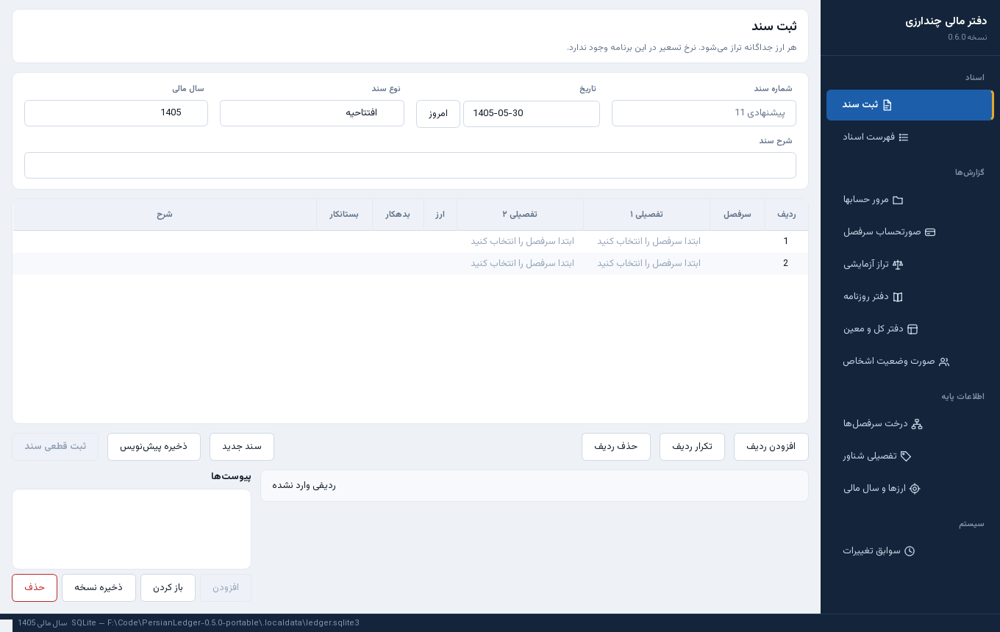
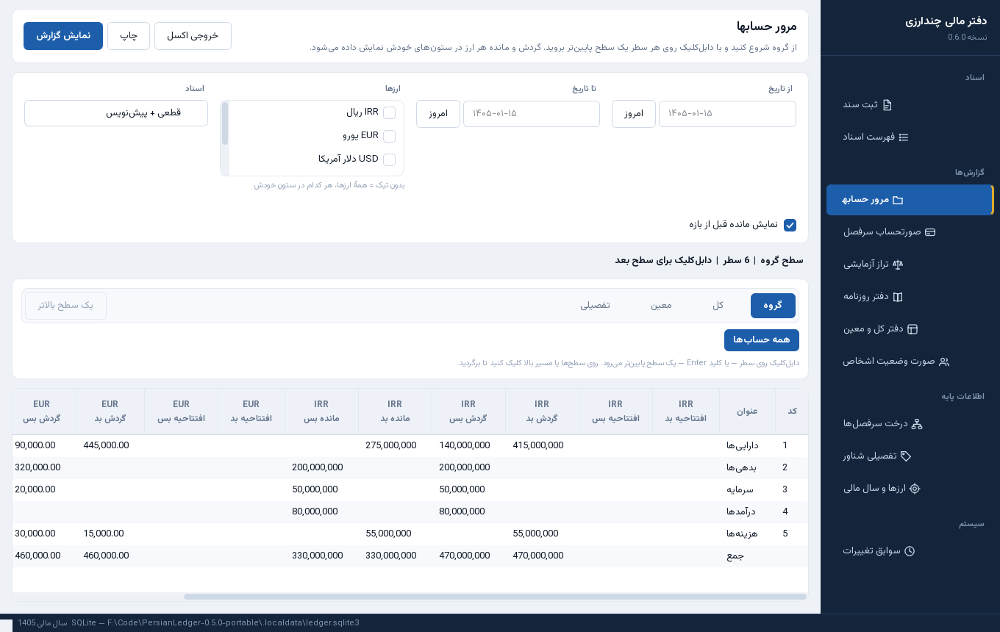
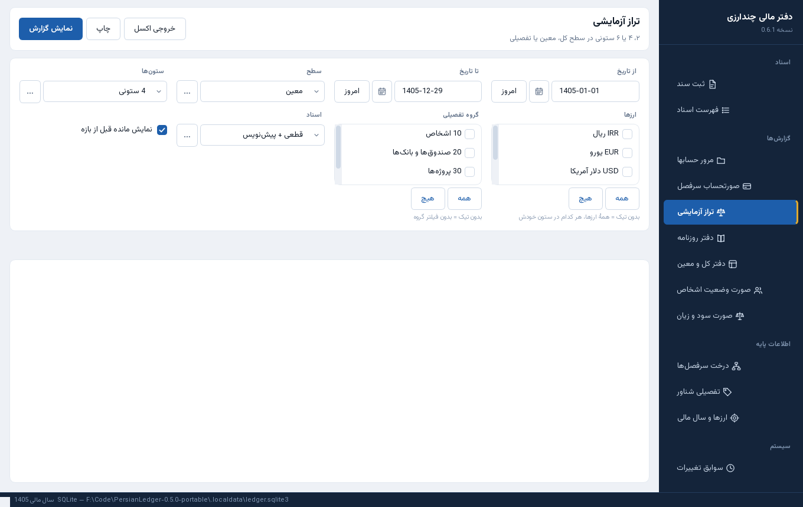
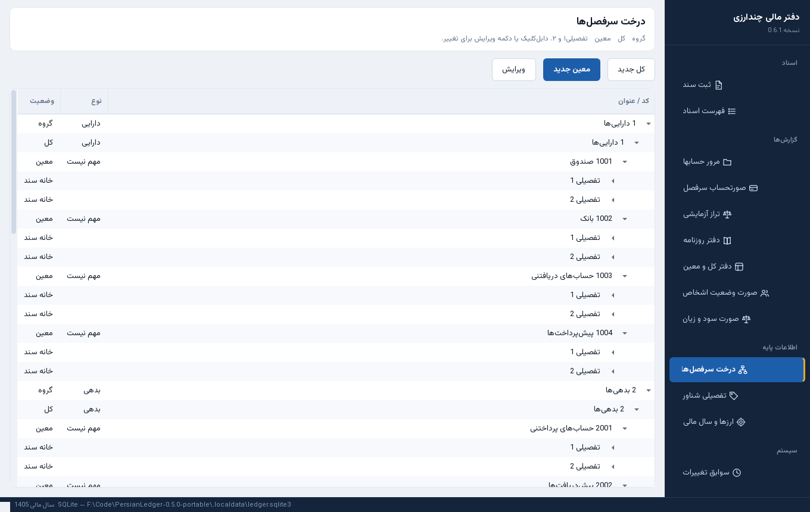

# PersianLedger

A desktop multi-currency ledger. Each currency stays in its own double-entry books. Dates are Jalali. There is no exchange rate anywhere in the system.

## Overview

PersianLedger is an offline Windows application for recording balanced journal entries across several currencies at once. Posted documents are immutable for a non-admin. An admin can return a posted document to draft, or delete it, and the action stays in the audit trail.

## Features

- Double-entry documents that must balance in each currency
- Chart of accounts, floating detail accounts, and party statements
- Jalali dates
- SQLite on one machine, or PostgreSQL when several people share one office server
- Attachments stored with the database, plus a local cache in server mode
- Portable build and an installed build
- Alembic migrations run on startup

## Technology Stack

- Python 3.11
- PySide6
- SQLAlchemy and Alembic
- SQLite by default
- PostgreSQL for the office server
- pytest

## Architecture

The local file is `.localdata/ledger.sqlite3`, or `data/ledger.sqlite3` next to a portable executable. Server mode points the same application at a PostgreSQL database on the office network. The PostgreSQL password is stored in the Windows keyring when that is available, and in the ini file when it is not.

| | SQLite | PostgreSQL |
| --- | --- | --- |
| Books | `.localdata/ledger.sqlite3` or `data/ledger.sqlite3` | The office server |
| Attachments | Inside the database file, plus `attachments-cache` | The same pattern |

## Installation

```powershell
python -m venv .venv
.\.venv\Scripts\pip install -r requirements-dev.txt
.\.venv\Scripts\python run.py --demo
```

Without `--demo`, startup creates only the base chart and the current fiscal year.

The application runs `alembic upgrade head` itself. To run it by hand:

```powershell
.\.venv\Scripts\alembic upgrade head
```

`alembic.ini` points at `.localdata\ledger.sqlite3` by default.

Portable build:

```powershell
.\.venv\Scripts\pyinstaller packaging\persianledger.spec --noconfirm
```

Output is `dist\PersianLedger\`. A `portable.txt` file next to the executable keeps data in `data\`.

Office server setup is in `docs/deploy-server.md`.

## Usage

Open the application and record documents from the journal screen. The end-user layout, installers, and data paths are described in `docs/README.md`. The screen-by-screen guide is `docs/user-guide.md`.

## Screenshots

Captured from the real 0.6.0 UI. Labels are Persian because that is the product interface.

| Document entry | Account browse |
| --- | --- |
|  |  |

| Trial balance | Chart of accounts |
| --- | --- |
|  |  |

Light and dark captures for every main screen are in `docs/ui-before-after/`. The office network walkthrough with real Windows screenshots is `docs/network-guide/index.html`.

## Testing

```powershell
.\.venv\Scripts\python -m pytest tests -q
```

PostgreSQL cases are skipped unless `PL_TEST_PG_URL` is set.

## Limitations

The interface is Persian and right-to-left because that is the product. This README is the English overview. Network access from outside the office, and a VPN, are not part of the current server guide.

## License

See the repository license file if one is present.
